<p align="center">
  <a href="https://64train.com/"></a>
</p>

<p align="center">
  <a href="https://64train.com/"></a>
  <a href="https://www.linkedin.com/in/alejandro-ruiz-mu%C3%B1oz-b41483216/"></a>
  <a href="mailto:alejandro@64train.com"></a>
</p>

<p align="center">
  <a href="#about-me"></a>
</p>

---

### About me

I'm a full-stack developer at **[64 Software Train](https://64train.com/)**, based in Málaga. I design and build web and mobile products end to end, from the database and the Laravel API to the Vue interface and the Oracle Cloud infrastructure they run on.

These days most of my work is about **AI agents and automation**. I design agents with Claude, connect them to real systems through tools and MCP servers, and turn repetitive processes into pipelines that run on their own.

```ts
const alejandro = {
  role:      "Full-Stack Developer & AI Automation Engineer",
  company:   "64 Software Train",
  location:  "Málaga, Spain",
  frontend:  ["Vue 3", "TypeScript", "Pinia", "Tailwind", "Ionic", "Capacitor"],
  backend:   ["Laravel", "PHP", "Node.js", "Python", "REST", "WebSockets"],
  ai:        ["Claude API", "Agent SDK", "Claude Code", "MCP servers", "Multi-agent workflows"],
  cloud:     ["Oracle Cloud (OCI)", "Docker", "Linux", "CI/CD"],
  languages: ["Spanish", "English"],
};
```

### What I do

<table>
  <tr>
    <td width="50%" valign="top">
      <h4>AI Agents & Automation</h4>
      Agents built on the Claude API and Agent SDK, custom tools and <b>MCP servers</b> that connect them to business data, and multi-agent workflows that automate real processes from start to finish.
    </td>
    <td width="50%" valign="top">
      <h4>Full-Stack Web Apps</h4>
      <b>Vue 3 + Laravel</b> products, from MVP to production SaaS: clean architecture (DDD, modular monoliths), solid APIs, real-time features and admin panels.
    </td>
  </tr>
  <tr>
    <td width="50%" valign="top">
      <h4>Cloud & DevOps</h4>
      Deployments on <b>Oracle Cloud Infrastructure</b>: compute, networking, storage, containers with Docker and automated CI/CD pipelines.
    </td>
    <td width="50%" valign="top">
      <h4>Mobile & Beyond</h4>
      Cross-platform apps with <b>Ionic + Capacitor</b>, NFC and IoT integrations (Android HCE, Raspberry Pi), Smart TV apps and serious games.
    </td>
  </tr>
</table>

### Selected work

| Domain | What I built |
|---|---|
| **E-learning** | LMS platforms, course builders and an interactive visual-novel engine for language learning |
| **Access control** | An NFC access system: Android HCE app, FastAPI backend, admin panel and Raspberry Pi reader |
| **Gamification** | A geolocated photo gamification app (Laravel 12 + Filament + Ionic + Vue) |
| **SaaS** | A community management platform with real-time notifications, web and mobile |
| **AI** | Agents and automations with Claude that run internal processes from start to finish |

### Tech stack

<p>
  <a href="#tech-stack"></a>
</p>
<p>
  <a href="#tech-stack"></a>
</p>
<p>
  <a href="#tech-stack"></a>
</p>
<p>
  <a href="https://www.anthropic.com/claude"></a>
  <a href="https://modelcontextprotocol.io"></a>
  <a href="https://www.oracle.com/cloud/"></a>
  <a href="https://ionicframework.com"></a>
  <a href="https://capacitorjs.com"></a>
  <a href="https://filamentphp.com"></a>
</p>

---

<details>
<summary><b>Leer en español</b></summary>

<br/>

### Sobre mí

Soy desarrollador full-stack en **[64 Software Train](https://64train.com/)**, en Málaga. Diseño y construyo productos web y móviles de principio a fin, desde la base de datos y la API en Laravel hasta la interfaz en Vue y la infraestructura en Oracle Cloud.

Hoy la mayor parte de mi trabajo gira en torno a los **agentes de IA y la automatización**. Diseño agentes con Claude, los conecto a sistemas reales mediante herramientas y servidores MCP, y convierto procesos repetitivos en flujos que funcionan solos.

### Qué hago

- **Agentes de IA y automatización**: Claude API, Agent SDK, Claude Code, servidores MCP y flujos multiagente
- **Aplicaciones web full-stack**: Vue 3 + Laravel, del MVP al SaaS en producción, con DDD y APIs sólidas
- **Cloud y DevOps**: despliegues en Oracle Cloud Infrastructure (OCI), Docker, Linux y CI/CD
- **Móvil y más**: apps multiplataforma con Ionic + Capacitor, integraciones NFC e IoT, apps para Smart TV y juegos serios

### Proyectos destacados

- Plataformas de formación (LMS), creadores de cursos y un motor de novela visual para aprender idiomas
- Un sistema de control de acceso NFC: app Android HCE, backend FastAPI, panel de administración y lector en Raspberry Pi
- Una app de gamificación fotográfica geolocalizada
- Una plataforma SaaS de gestión de comunidades con notificaciones en tiempo real
- Agentes y automatizaciones con Claude que resuelven procesos internos de principio a fin

**Contacto:** [alejandro@64train.com](mailto:alejandro@64train.com) · [LinkedIn](https://www.linkedin.com/in/alejandro-ruiz-mu%C3%B1oz-b41483216/) · [64train.com](https://64train.com/)

</details>

<p align="center">
  <sub>Open to collaborations on AI agents, automation and Vue/Laravel products · Abierto a colaborar en agentes de IA, automatización y productos Vue/Laravel</sub>
</p>
